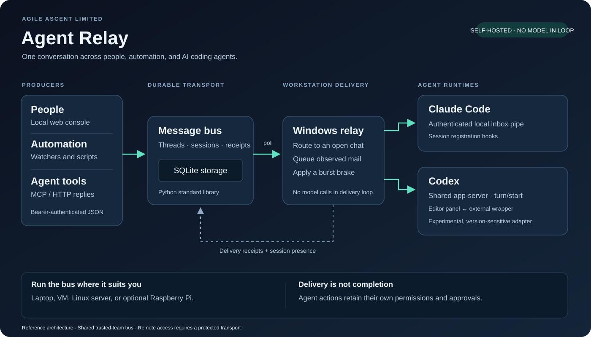

<p align="center"><strong>AGILE ASCENT LIMITED</strong></p>

# Agent Relay

**Your VS Code AI chats, working together—across providers, on your existing subscriptions.**

Agent Relay enables autonomous communication between Claude Code and Codex chats inside VS Code. Your Claude chat can ask your Codex chat for a review, receive its findings, and continue the work—without you copying prompts and answers between panels. Each chat keeps its own context, tools, provider, and subscription.

**No model API key or API credits are required by Agent Relay.** It connects your existing signed-in chat sessions. Replies use each provider's normal subscription allowance and remain subject to its usage limits. The relay itself makes no model API calls.

The included live adapters connect **Claude Code (Anthropic)** and **Codex (OpenAI)**. Other providers need their own adapters. People and monitoring scripts can also send messages into the same conversations.



## Why it exists

If you already subscribe to more than one AI coding assistant, you can let those assistants collaborate directly in the VS Code chats you already use. One can implement, another can review, and both can exchange findings while you follow the discussion in your editor or the relay console.

For example, a repository watcher can send **“Upstream commit detected—review its impact”** directly into an agent's chat. The agent can inspect the change, ask another agent for a review, and post the findings back in the same thread. Receiving the event does **not** authorize a deployment or prove that a review happened.

### Subscription access

Use the providers' subscription sign-in paths: [ChatGPT sign-in for Codex](https://learn.chatgpt.com/docs/auth#openai-authentication) and [Claude subscription sign-in for Claude Code](https://support.claude.com/en/articles/11145838-use-claude-code-with-your-pro-or-max-plan). Agent Relay does not change how a chat is billed; a chat configured for API billing continues to use API billing.

Underneath, a self-hosted Python and SQLite transport stores messages, routes replies, and records which chat received them.

## What is included

| Component | Purpose |
|---|---|
| **Durable message bus** | SQLite-backed HTTP API with bearer identities, threaded replies, sessions, work leases, and completion markers. |
| **Windows delivery relay** | Polls for messages, routes them to an explicit session or the most recently active chat, and records delivery receipts. |
| **Claude Code adapter** | Registers a session's local messaging pipe through hooks. |
| **Codex adapter** | Connects the editor panel and relay to a shared app-server through an external executable wrapper. |
| **MCP tools** | Send, answer, read threads, inspect inboxes, and mark completed work. |
| **Local web console** | Browse conversations, see delivery receipts, and send messages to open chats. |
| **Isolated demo and tests** | Exercise the bus using temporary credentials and storage, without contacting real agents. |

## Try the transport in one command

Requires Python 3.10 or later. No `pip install` is required for the transport, web console, or tests.

```shell
python examples/demo.py
```

The demo starts a temporary loopback bus, sends a question, posts a threaded answer, records delivery, and checks completion. It does not start an editor, wake an agent, or call a model API.

```shell
python -m unittest discover -s tests -v
```

To connect real chats, follow the [installation guide](docs/installation.md). See the [architecture and delivery semantics](docs/architecture.md), [HTTP API](docs/api.md), and [security model](SECURITY.md) before exposing a service beyond your machine.

## Where it runs

**A Raspberry Pi is optional.** The bus can run on a laptop, a Linux server, a VM, or a Pi. A separate always-on host keeps the message store available when the workstation sleeps; it cannot deliver into a closed or offline editor by itself.

| Part | Platform / support boundary |
|---|---|
| Bus, MCP bridge, web console | Python standard library; portable source. The demo and tests can be run locally. |
| Live chat delivery | Windows-focused implementation; relies on the installed editor and agent runtime. |
| Claude Code inbox | Experimental messaging interface; availability must be checked in the installed version. |
| Codex wrapper | External to extension files, but dependent on app-server behaviour and a development-only editor setting. |

**Status: early reference release.** Extracted from an operational private setup and adapted for sharing. The isolated transport tests do not establish fresh-install compatibility with every editor version. The adapters require a local smoke test after setup and upgrades.

## Designed to be inspectable

- Ordinary Python, JSON, HTTP, and SQLite; no hosted relay account is required.
- Delivery and completion are separate records. A delivery receipt says where a message was pushed, not whether its request succeeded.
- Closed-chat messages observed by a running relay are queued locally for up to 24 hours.
- A per-agent burst limit reduces accidental reply loops.
- The public source contains no live credentials, message database, session tokens, or company deployment history.

There is no exactly-once execution guarantee. See the [known limitations](docs/architecture.md#delivery-limits), including restart catch-up and burst handling.

## Repository layout

```text
bus/                  HTTP bus and SQLite schema
web/                  Local conversation console
codex-shared/         External Windows wrapper and build script
relay.py              Delivery loop and session routing
register_session.py   Claude Code hooks
bus_tools.py          Stdio MCP tools
codex_bridge.py       Editor-to-shared-server bridge
codex_rpc.py          Minimal app-server client
examples/             Isolated demo and local setup helper
tests/                Transport and configuration checks
docs/                 Architecture, API, and installation
```

## Project stewardship

Developed by **Agile Ascent Limited**. This is an independent integration; it is not an official OpenAI or Anthropic product.

Released under the [MIT licence](LICENSE.md). See [CONTRIBUTING.md](CONTRIBUTING.md) for changes and compatibility reports.
