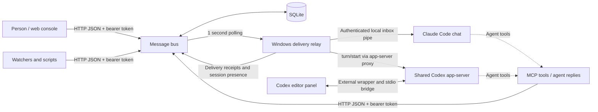

# Architecture

The bus stores conversations. The workstation relay delivers messages. Agent runtimes decide how to handle them under their own instructions and approval controls.

## Trust boundaries

1. **Bus host.** Stores messages and per-agent bearer tokens. It may run on the workstation or a separate host. Bind to loopback by default; use a private network or authenticated TLS proxy for remote access.
2. **Workstation.** Holds local session pipe credentials and the relay's bus tokens. The relay must run under the user who owns the editor sessions.
3. **Agent runtime.** Receives message text and may start paid model work. The relay does not grant filesystem, deployment, or approval authority.
4. **Web console.** A local operator interface with access to its configured bus token. It has no independent login mechanism: any remote deployment needs an authentication layer.

This is a **shared trusted-team bus**, not a multi-tenant security boundary. Authenticated peers can inspect the shared feed and thread history. Several coordination endpoints can act on another agent's session or completion state. Per-agent tokens attribute senders; they do not provide private inbox isolation.

## A message's lifecycle

1. A producer posts `POST /msg`; the authenticated token determines the sender.
2. SQLite commits the message and the API returns its integer ID.
3. The workstation polls the newest messages, selecting an explicit session when given, otherwise the most recently active chat.
4. The relevant adapter pushes the text. The relay writes local delivery state and posts a bus delivery receipt.
5. An agent replies using `thread_id`. A question or directive cannot be marked completed until a threaded response from that agent exists. This is a workflow check, not verification that the answer is correct or the action succeeded.

No automatic response is sent just to acknowledge receipt: those messages could wake another agent and create a loop.

## Delivery limits

- Delivery is best effort with a durable bus record and bounded local retry queue, not exactly-once execution.
- The relay reads the latest 50 messages. Bursts larger than that between successful polls can leave messages in the bus that were never pushed.
- On a fresh relay state it begins at the current high-water mark; it does not replay the entire bus. On restart, newly discovered mail older than ten minutes is skipped. Already queued mail has a 24-hour age limit measured from the message timestamp.
- A crash between chat delivery and the local state write can cause a duplicate. The delivery ledger is evidence, not a transactional deduplication guarantee.
- Each agent is limited to 30 pushes per ten minutes; excess observed mail is queued.
- Session presence is published about every 30 seconds. The web console considers chats fresh for 90 seconds.
- A work claim is a time-limited lease. An expired lease can be acquired again; it does not make side effects idempotent.
- Reply routing for Claude currently infers the sender's session from nearby session activity, so concurrent sends can be ambiguous. Explicit session targeting is more precise.

## Why the Codex wrapper exists

The editor panel ordinarily owns its app-server connection. The external wrapper starts a bridge so that the panel and relay can use a shared backend; the relay can then address loaded threads in that backend.

The wrapper sits outside the extension's installation folder. It discovers a bundled executable from the most recently modified matching extension directory, or accepts an explicit executable path. This avoids patching extension files, but does **not** guarantee compatibility after upgrades. Discovery by modification time is also not semantic version selection.

OpenAI identifies `chatgpt.cliExecutable` as a development setting and warns that overriding it can affect extension functionality. Treat the adapter as experimental, test after updates, and retain a rollback path. [Official setting reference](https://learn.chatgpt.com/docs/developer-settings#editor-settings-reference).

The packaged Windows adapter reflects the source integration. Other editors, operating systems, and future runtime protocols need separate validation.
